# lias Corne — ZMK config

ZMK firmware config for my Eyelash Corne (nice!nano v2 + nice!view, wireless split).
It combines the keyboard maker's config ([a741725193/zmk-new_corne](https://github.com/a741725193/zmk-new_corne)) with my own fixes for stutter, lag and battery drain.

## Flashing

1. Push a change, then open **Actions → Build ZMK firmware** and wait for the green tick.
2. Download the `firmware` artifact from the bottom of the run page.
3. Double-tap the reset button on a half, then drag its file onto the drive that appears:
   - left half: `eyelash_corne_studio_left`
   - right half: `eyelash_corne_right nice_view-nice_nano_v2-zmk`
4. Only if the halves stop finding each other or Bluetooth pairing breaks: flash `settings_reset` to both halves first, then the files above, and re-pair on the computer.

## What's set up

| Feature | How to use it |
|---|---|
| Space / Enter thumb keys | Tap for Space/Enter, hold for the Fn layer. While typing fast they always tap instantly. Tap then hold to auto-repeat. |
| Joystick | Arrows + Enter on the base layer. Holding any layer key turns it into a mouse pointer, centre press = left click. |
| Encoder | Volume. Can be remapped in DYA Studio without reflashing. |
| Backlight | 40% at start, off after 30 s idle. Hold NUMBER (left thumb) + C to toggle, + V to cycle brightness. |
| Soft off | Hold Fn (Space) + hold Tab for 2 s. Both halves switch fully off for carrying. Press each half's reset button once to wake. |
| Sleep | Deep sleep after 1 hour without typing. The first keypress after that wakes it and is not typed. |
| Bluetooth | 1M radio mode for a more stable link (`CONFIG_ZMK_BLE_EXPERIMENTAL_CONN`). Connection interval stays at ZMK defaults; forcing it caused the freeze + key-repeat spam in Sept 2026. |

## Layers

- **QWERTY** — base layer
- **NUMBER** — hold left thumb key: numbers, Bluetooth profiles, arrows, RGB and backlight controls
- **SYMBOL** — hold right thumb key: symbols, mouse buttons, USB/BLE output switch
- **Fn** — hold Space or Enter: F-keys, mouse buttons, reset and bootloader keys

The keyboard maker's original guide (hardware, DYA Studio, ZMK Studio) is in [README_EN.md](README_EN.md).
